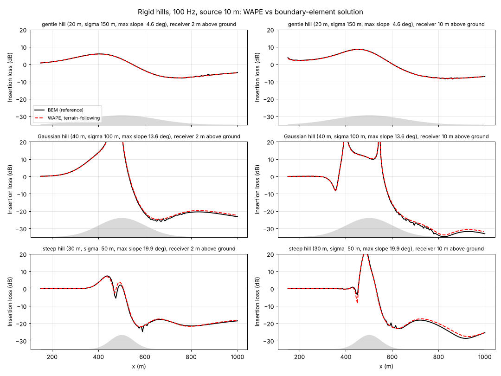

# Wide Angle Parabolic Equation model with arbitrary Mach number


The WAPE model proposed here is an implementation of the work of [Ostashev et al 2020]. The WAPE is developed using a Padé(1,1) series expansion. A Crank-Nicholson algorithm is used to reduce the equation into a matrix system. Then, the 2D acoustic pressure field is calculated using a second-order centered finite difference scheme on velocity potential.

This code is intended to be shared with the research community.

## Installation
This WAPE model is designed to run with [Matlab](https://www.mathworks.com/products/matlab.html), without any additonal toolbox.

## Run a calculation
To run a calculation you need to open "initialisation_WAPE.m", set parameters values, and run the script. It is indicated which parameter can be modified and which can not.

The input parameters are:

```Matlab
%% Source parameters
freq = 250;  % source frequency (Hz)
hS = 35;     % source height (m)

%% Medium properties
T = 10;      % atmospheric temperature at the surface (°C)
Tlog = 0.2;  % temperature coefficient for the vertical gradient

shear_exp = 0.15;    % wind shear exponents (scalar) for power law wind profil
v_ref = 5;          % wind speed (m/s) measured at z_ref height, for power-law wind profile
z_ref = 80;          % reference height for wind speed v_ref
theta = 0;         % propagation angle with respect to the source (0° : downwind, 180° : upwind)

f_turb_ind = true;   % logical 'true' or 'false' to account for turbulence or not
gamT = 0;            % turbulence strength

%% 2D Spatial domain (x,z)
dim_x = 3000; % horizontal dimension x of the domain (m)
dim_z = 300;  % vertical dimension z of the domain (m)

haut_a = 0.8; % where the absorbing layer starts at the top of the domain, according to z axis (0.8 ==> start at 80% of z axis)
coeff_a = 10; % damping rate

discrx = 10;  % discretization x = lambda/discrx
discrz = 10;  % discretization z = lambda/discrz

z_r = 1.5;    % receiver height for plotting (m)

%% Ground properties
hv = 0;       % vegetation height (m), it affects the shape of atmospheric profils
z0 = 0.13*hv + 0.00001;  % atmospheric roughness length (m), can't be null
d = 0.66*hv;   % displacement height of flux profiles (m), it's directly linked to vegetation height

lc = 0 ;       % correlation length (m) (ground roughness parameter), if 0 : no ground rugositiy, [0.05-1]
sigmah = 0;    % standard deviation of roughness height (m) (ground roughness parameter), [0.01-0.05]
sigma = 10000000;  % airflow resistivity of the ground (kN.s.m-4)
h = 0;         % thickness of ground surface layer (m), if h = 0 no layer
```

## Terrain (topography) and mixed ground

The model can propagate over uneven terrain. The ground height profile along the propagation path is given in `initialisation_WAPE.m`:

```Matlab
%% Terrain (topography)
terrain.x = [0 dim_x];   % profile abscissae (m)
terrain.h = [0 0];       % ground height (m), piecewise-linear between points
terrain.smooth = 0;      % std of a Gaussian smoothing window (m), 0 : none
```

The source is at `hS` above the ground at x = 0, receivers and plots use heights above the local ground (`z_r`), and the post-processing (free-field reference, atmospheric absorption, turbulence) uses absolute coordinates. The ground impedance can also change along the path:

```Matlab
ground_x = [0 1000 2000];            % start of each ground segment (m)
ground_sigma = [200 20000 200];      % airflow resistivity of each segment
ground_h = [0 0 0];                  % layer thickness of each segment (m)
```

### Method

The equation is solved in terrain-following coordinates, zeta = z - H(x) being the height above the local ground [Sack & West 1995]. For a local slope s = H'(x) = tan(thetaG), the exact change of variables in the Helmholtz equation shows that the envelope w, defined by

    phi = w * exp(i k0 sin(thetaG) zeta) * exp(i int k0 (sqrt(1+s^2) - 1) dx),

obeys the flat-ground WAPE written in the frame aligned with the slope, i.e. with a marching step `delta_x*sqrt(1+s^2)` and a vertical step `delta_z/sqrt(1+s^2)`. Therefore:

- the Crank-Nicholson matrices are the flat-ground ones built with these effective steps (they are cached and rebuilt only when the slope changes);
- slope changes (terrain curvature) are applied as phase screens `exp(-i k0 d(sin thetaG) zeta)` before and after each step (Strang splitting). For small slopes this is the curvature term `eps_eff = eps - 2 zeta H''(x)` of the GT-PE [Sack & West 1995];
- the ground boundary condition, the absorbing layer and the wind/temperature profiles (functions of the height above ground) are unchanged.

For a uniform slope this is equivalent to a rotated PE [Collins 1990]; for flat ground it reduces exactly to the original solver.

### Validation (`tests/`)

Run from the repository root, in Matlab or Octave:

```Matlab
addpath tests tests/reference
test_flat_regression       % flat ground: identical to the original solver
test_slope_analytic        % uniform slopes vs exact image-source solution
test_terrain_vs_bem        % hills vs an independent 2D boundary-element solution
```

Results (Octave 8.4):

| Case | Reference | Error |
|---|---|---|
| Flat ground | original solver | identical (0 difference) |
| Uniform slope 5.7° / 11.3° / 16.7° | exact image solution | 0.10 / 0.21 / 0.33 dB rms outside interference nulls |
| Hill, max slope 4.6° | BEM | 0.08–0.11 dB rms |
| Hill, max slope 13.6° | BEM | 0.59–0.62 dB rms |
| Hill, max slope 19.9° | BEM | 0.69–0.86 dB rms |

The BEM reference (`tests/reference/bem_reference.mat`) was computed with λ/40 elements; the difference with λ/30 is 0.06–0.32 dB. To regenerate it: `make_bem_reference` (slow).



### Limitations

- Slopes up to about 15-20 deg (a warning is issued above 20 deg). The Pade(1,1) WAPE is limited to about 35 deg from the local slope direction, and the slope uses part of this aperture.
- Steep or vertical features (cliffs, walls, buildings) and back-scattering are not modelled: couple the PE with a local FDTD/BEM model for those.
- The wind is taken along x with the profile of the height above the local ground; flow speed-up over hills is not modelled (an x-dependent Mach profile from a flow model would be needed).
- Terrain profiles from DEMs should be smoothed (`terrain.smooth`, e.g. a few wavelengths) to remove noise.

## Post-processing
When the simulation has completed there will be 'DeltaL.mat' and  'normalized_SPL.mat' files which correspond respectively to attenuation to free field (dB), and sound pressure level field (dB) which is normalized by the maximum amplitude. You can post-process these signals to your liking. Here is an exemple of output:

 

## Warning
Instabilities can occur with PE simulations if:
- the spatial steps are too large,
- the absorbent layer at the top of the domain is not thick enough.

Calculation time can be really long and take a lot of memory if: 
- the spatial steps are too small,
- the domain is too big,
- the frequency is too high.

## License
This code is released under the EUPL license.

## Credits
The development of this code took part into the french [PIBE project](https://www.anr-pibe.com/) (contract ANR-18-CE04-0011).

## Citing this work
If this WAPE script contributes to an academic publication, please cite it as:

      @misc{kayser_wide_2023,
	title = {Wide-angle parabolic equation model},
	url = {https://github.com/bkayser13/WAPE/},
	author = {Kayser, Bill},
	year = {2023},
	note = {https://github.com/bkayser13/WAPE/},
	}

## Some background references

This code largely implements algorithms that have already been published. A non-exhaustive list is proposed below.

Tappert, F. D. (1977). The parabolic approximation method. Wave propagation and underwater acoustics, 224-287.

Gilbert, K. E., & White, M. J. (1989). Application of the parabolic equation to sound propagation in a refracting atmosphere. The Journal of the Acoustical Society of America, 85(2), 630-637.

West, M., Gilbert, K., & Sack, R. A. (1992). A tutorial on the parabolic equation (PE) model used for long range sound propagation in the atmosphere. Applied Acoustics, 37(1), 31-49.

Collins, M. D. (1993). A split‐step Padé solution for the parabolic equation method. The Journal of the Acoustical Society of America, 93(4), 1736-1742.

Ostashev, V. E., Juvé, D., & Blanc-Benon, P. (1997). Derivation of a wide-angle parabolic equation for sound waves in inhomogeneous moving media. Acta Acustica united with Acustica, 83(3), 455-460.

Dallois, L., Blanc-Benon, P., & Juvé, D. (2001). A wide-angle parabolic equation for acoustic waves in inhomogeneous moving media: Applications to atmospheric sound propagation. Journal of Computational Acoustics, 9(02), 477-494.

Lihoreau, B., Gauvreau, B., Bérengier, M., Blanc-Benon, P., & Calmet, I. (2006). Outdoor sound propagation modeling in realistic environments: Application of coupled parabolic and atmospheric models. The Journal of the Acoustical Society of America, 120(1), 110-119.

Cheinet, S. (2012). A numerical approach to sound levels in near-surface refractive shadows. The Journal of the Acoustical Society of America, 131(3), 1946-1958.

Kayser, B., Gauvreau, B., & Ecotière, D. (2019). Sensitivity analysis of a parabolic equation model to ground impedance and surface roughness for wind turbine noise. The Journal of the Acoustical Society of America, 146(5), 3222-3231.

Ostashev, V. E., Muhlestein, M. B., & Wilson, D. K. (2019). Extra-wide-angle parabolic equations in motionless and moving media. The Journal of the Acoustical Society of America, 145(2), 1031-1047.

Ostashev, V. E., Wilson, D. K., & Muhlestein, M. B. (2020). Wave and extra-wide-angle parabolic equations for sound propagation in a moving atmosphere. The Journal of the Acoustical Society of America, 147(6), 3969-3984.
